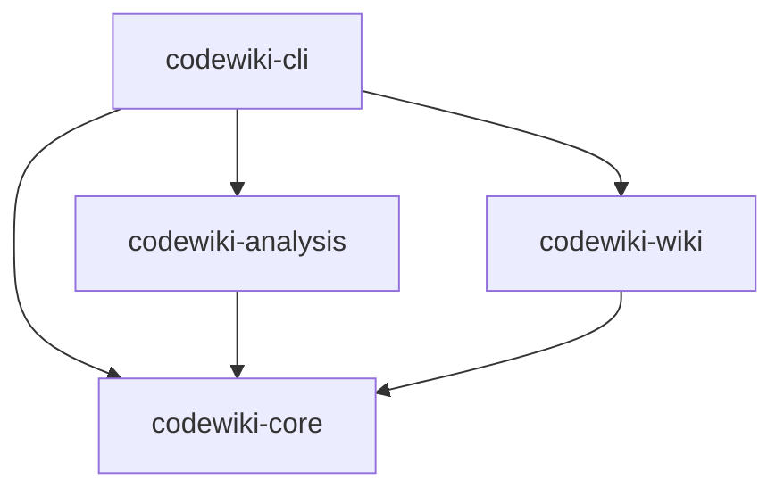
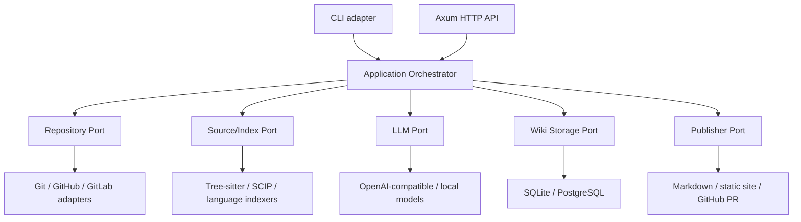
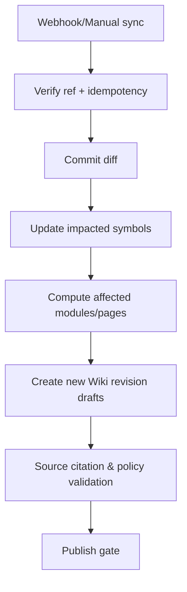

# 系统架构设计（Architecture v0.1）

- 日期：2026-10-18
- 决策：**Rust Cargo Workspace，Library-first，模块化单体，Hexagonal Ports/Adapters**
- 稳定边界：代码事实、知识生成、Wiki 内容服务分离
- 当前实现与未来设计严格分栏，避免文档领先代码的误导

## 1. 目标与约束

目标是让同一分析核心同时被 Rust crates、CLI 与将来的 API server 调用。任何核心算法都不得依赖 UI、数据库、HTTP 或特定模型供应商。支持离线分析和服务端异步任务。原则上不用把 Python 运行时或浏览器内核绑定到 CLI 包。

非功能约束：
- 安全：仓库始终视作不可信输入；默认禁用执行构建脚本。
- 正确性：关键事实可追溯到代码快照，启发式关系需标可信度。
- 性能：避免一次把全仓文件内容装入内存；后续 AST 与图谱需要预算控制。
- 可维护性：每个库有清晰单向依赖。
- 可演进性：SQLite 与 PostgreSQL、CLI 与 Web 仅是不同适配器。

## 2. 当前（已落地）依赖结构



| crate | 当前职责 | 约束 |
|---|---|---|
| `codewiki-core` | 错误、SourceFile、ScanReport、WikiPage、WikiBundle | 不依赖文件系统、HTTP、数据库、AI |
| `codewiki-analysis` | 遍历工作目录、ignore/敏感文件过滤、SHA-256 内容指纹 | 不执行仓库代码，不调用 LLM |
| `codewiki-wiki` | 基于顶层目录生成页面、导出 Markdown、防止非授权覆盖 | 不调用网络，也不推断业务含义 |
| `codewiki-cli` | 命令参数、错误输出、组合库调用 | 禁止把业务逻辑堆在 main.rs |

当前仅拥有文件清单和静态 Wiki 目录；**没有 AST、跨文件调用图、Git 对象版本、AI、数据库、权限系统**。`codewiki-core` 数据格式会在 v0.x 版本演进，不承诺已稳定的公共 API。

## 3. 目标（未来实现）领域分层



推荐未来按需求拆出 `codewiki-git`、`codewiki-parser`、`codewiki-storage`、`codewiki-llm`、`codewiki-server`，**不要现在创建空 crate**。`codewiki-core` 保持无副作用纯模型，`codewiki-analysis` 封装语义解析与中间图，`codewiki-wiki` 提供知识编译与页面版本逻辑。

### 3.1 Ports（接口边界）

以下是接口职责设计，不是现有 Rust trait：

| Port | 输入 | 输出 |
|---|---|---|
| RepositoryProvider | Git URL/本地路径、ref、读取身份 | 固定 Revision 的 Snapshot |
| SourceAnalyzer | Snapshot、过滤与语言策略 | 符号索引、依赖与调用关系、覆盖率 |
| ModulePlanner | 结构图、拆分策略、人工目录约束 | 可编辑的模块/页面计划 |
| KnowledgeGenerator | EvidenceBundle、模板、预算 | 结构化内容草稿及证据列表 |
| CitationValidator | WikiDraft、Snapshot/Index | 引用有效性与问题报告 |
| WikiRepository | Workspace、page/revision/transaction | 不可变修订、草稿、发布记录 |
| Publisher | ApprovedPublication、目标适配器 | 导出结果/PR/只读发布 |
| JobQueue | 幂等任务键、任务配置 | 状态、检查点与取消 |

在多种 I/O 运行时之间保持接口简洁；未来可能使用异步 trait，但不要无必要地将 tokio 类型泄漏进纯核心。

## 4. 四种必须分离的数据

1. **RepositorySnapshot**：仓库、Commit SHA、submodule/shallow 状态、忽略策略、解析配置。
2. **CodeIndex**：SourceFile、Symbol、Edge、定位、置信度、来源 hash、索引 schema 版本。
3. **KnowledgeDraft**：模块解释、架构图、事实证据、模型与 prompt 版本、生成预算。
4. **WikiDocument**：独立 page_id、block_id、revision、author、visibility、publication_id。

代码提交后快照不可变；内容生成可以重复运行；人工修订永不从代码事实层反向覆盖。人工文档与生成段落可采用分块的 ownership / update policy。

### 4.1 稳定符号定位

初步候选：repo_id、language、qualified_name、signature、source_fingerprint、revision。另设不可变内部 symbol_id。重命名/移动文件需要单独实体匹配；路径或行号不能作为永久主键。

关系边至少应包含 source_id、target_id、kind、resolution_method、confidence、snapshot_id。精确语义与启发式解析须区分。

### 4.2 代码引用

每条 `WikiCitation` 具有 repo_id、snapshot_id、path、start_line、end_line、content_digest、validation_state。发布时验证实际文件、行范围和引用指纹。新的 commit 不得直接复用旧行号。失效引用应提示用户，不要替换成不真实的证据。

## 5. 模块拆分：图驱动 + 工程结构约束

数据管线：


拆分策略：
- 首先尊重 Maven/Gradle/Cargo/npm 等真实工程边界。
- 结合依赖图边密度、文件夹结构、实体名称和规模限制做分组。
- 工程配置文件与部署产物成为独立分析对象。
- 强耦合循环依赖应该反映为候选模块风险，而不是被 AI 隐藏。
- Wiki 页面与 RAG chunk 不共享粒度；LLM 不能替代解析器生成精确事实。

## 6. Wiki 编辑、保存、分享的存储设计

本地版：SQLite/FTS5；团队版：PostgreSQL。两者共享领域层与迁移规则，不承诺 SQL 语句完全相同。

核心概念表（目标，不是已执行 migration）：

```text
workspaces, workspace_members, repositories, repository_snapshots
analysis_jobs, source_files, symbols, relations, source_evidence
wiki_pages, wiki_revisions, wiki_blocks, wiki_citations
publications, share_grants, audit_events
```

强制使用 append-only revisions（或可审计的等效模型），发布版本指向确定的一组 page revisions。用户编辑与生成器提案用三方合并或区块级 diff，失败时转人工审核。保留旧 Wiki 与历史链接。

权限在服务端 API 强制执行，按 workspace/repository/page/publication 分级控制。公开分享不得透传私有源码或未经审查的原始片段。

## 7. 增量编译与幂等任务

以 `repo_id + commit_sha + analyzer_version + policy_hash` 标记事实索引任务；页面生成以 `module_fingerprint + template_version + model_version + generation_policy` 建缓存键。



禁止“文件变了就重写整个 Wiki”。当影响范围超限时可全量重建**草稿**，人工区块仍需被保护。任务需支持取消、检查点、失败重试与费用上限。

## 8. 部署拓扑与第三方边界

- **嵌入式**：上游 Rust 程序依赖 `codewiki-analysis` / `codewiki-wiki`，无需启动服务。
- **CLI**：独立可执行文件；后续可选择 SQLite 缓存与远程模型。
- **自托管**：Axum 应用 + Postgres + 受限 Worker + 受控磁盘快照；前端 Web 与 API 分离构建。
- **大型部署**：只有出现证据后再拆异步 Worker、对象存储、向量与图服务。

若使用 GitHub App，私人仓库权限由 installation token 控制，密钥放系统安全存储；Webhook 必须做签名验证、幂等去重与 SSRF 防护。不自动运行 Git hooks/build scripts。

## 9. 性能和稳定性预算

建议起步监控：可处理文件数、解析覆盖率、最大单文件体积、增量耗时、依赖图规模、每页面模型成本、引用有效率。当前单文件阈值 1 MiB 属于 MVP 保守策略，并非正式大型仓库能力指标。

禁止静默忽略遍历报错或将未覆盖文件视为完整分析。性能瓶颈未测量前不要强制采用并行解析、Redis 或 Neo4j。

## 10. 重大决策与否决项

- 选择 Rust Workspace 而非一开始建立多个微服务，见 [ADR-0001](adr/0001-rust-workspace.md)。
- 将代码事实与 Wiki 修订分离，见 [ADR-0002](adr/0002-knowledge-and-revisions.md)。
- 不直接 Fork DeepWiki-Open/CodeWiki 并让其框架结构决定本项目边界。
- 不把完整 Git 客户端或 GPUI UI 绑定在核心 crate 中。
- 不以“AI 可以解释”为理由跳过来源验证。
- 不在 CI 成功前宣称工程已通过编译与测试。
