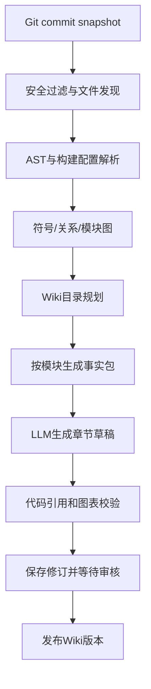

# CodeWiki 开源调研与产品可行性报告

- **版本**：v0.1 / 2026-10-18
- **目标**：Git 仓库接入 → 静态分析 → 模块拆分 → 持久化 Wiki → 增量更新 → 团队共享
- **结论**：采用 Rust library-first 分层架构；避免对单个开源生成器进行深度 Fork，优先复用其设计思想与可以合法集成的基础设施。
- **状态声明**：本报告包含未来产品设计与建议，并不表示相应功能已完成。

## 1. 产品定位

CodeWiki 不是简单的“输入仓库 URL，生成一次 Markdown”，而是代码知识管理平台。必须将三层数据分开：

| 层次 | 主要内容 | 更新与可信度 |
|---|---|---|
| 代码事实 | 文件、构建单元、符号、定义/引用、依赖、调用关系、证据 | 确定性或标注置信度，关联固定 Commit |
| 生成知识 | 架构说明、功能职责、业务流程、模块关系、图表 | LLM 解释，可验证、可重算 |
| Wiki 内容 | 页面结构、人工修订、评论、分享、出版版本 | 持久化，受权限与发布审批约束 |

用户先浏览已有知识，再按需对代码提出问题。问答不是唯一入口，Git 文件路径也不是唯一目录组织依据。

### 1.1 用户场景

1. 研发人员快速理解陌生仓库的功能结构、模块职责与调用链。
2. 技术负责人维护跨多仓库的系统架构与设计决策。
3. 团队将自动生成的技术知识与人工文档放在同一个空间协作。
4. 代码更新时仅刷新影响到的 Wiki 页面，不破坏人工编辑。
5. 使用本地 CLI、Rust crate 或服务端 API 复用相同的分析与 Wiki 编译能力。

### 1.2 非目标（首版）

首版不负责运行未知仓库、自动修复代码、取代 IDE、托管 Git 源代码或充当完整企业文档套件。全语言精确语义、复杂权限继承与实时多人编辑不是 Phase 0 交付项。

## 2. 已调研的开源项目

本节记录项目定位、值得借鉴之处及已确认的许可证。来源为官方 GitHub 仓库及项目自述；具体性能宣称尚未经过本项目独立基准验证。

| 项目 | 主要优势 | 本项目借鉴点 | LICENSE |
|---|---|---|---|
| [DeepWiki-Open](https://github.com/AsyncFuncAI/deepwiki-open) | Git 仓库输入、Wiki、图表、RAG、Code Map | 用户流程、章节阅读体验 | MIT |
| [FSoft-AI4Code/CodeWiki](https://github.com/FSoft-AI4Code/CodeWiki) | 依赖图、层次聚类、分层 Agent、模块级更新 | **模块拆分与增量 Wiki 生成** | MIT |
| [he-yufeng/RepoWiki](https://github.com/he-yufeng/RepoWiki) | 轻量 CLI、SQLite 缓存、文件排序、Markdown/HTML 导出 | 低成本缓存、导出格式和引用路径 | MIT |
| [fordjam/repowiki](https://github.com/fordjam/repowiki) | 对源文件/行号引用做验证、隐私预览 | 可验证输出、保密边界 | MIT |
| [gatesenman/codewiki](https://github.com/gatesenman/codewiki) | 代码实体、调用/引用图与导航 | 实体模型与关系导航 | MIT |
| [Raymonda/LLM-WIKI](https://github.com/Raymonda/LLM-WIKI) | 持续编入文档、团队知识与人工修订 | Wiki 持久化、治理与多人协作 | MIT |
| [Tree-sitter](https://github.com/tree-sitter/tree-sitter) | 多语言语法解析与增量语法树 | AST 提取基础设施 | MIT |
| [SCIP](https://github.com/scip-code/scip) | 符号定义/引用索引的交换格式 | 精确语义索引的可选后端 | Apache-2.0 |
| [Graphiti](https://github.com/getzep/graphiti) | 时序知识图谱 | 对知识边和有效期的设计参考 | Apache-2.0 |
| [Wiki.js](https://github.com/requarks/wiki) | 文档发布和管理 | UX 参考，避免直接复制受限实现 | AGPL-3.0 |
| [Outline](https://github.com/outline/outline) | 协作编辑体验 | UX 参考，**需核查 BSL 使用限制** | BSL 1.1 |

特别注意：Outline 当前仓库使用的 BSL 1.1 与 MIT/Apache 不同；Wiki.js 的 AGPL-3.0 对网络使用和修改版分发存在义务。对上述项目的“参考”默认是研究设计，而非导入源代码。任何复用均由独立许可证合规审查确定。其他语言的 Tree-sitter grammar、图表/UI 组件以及传递依赖也须独立核验。

### 2.1 深度比较：生成式 Wiki 的不足

一次性生成方案的长处是快速见效，弱点通常出现在：
- 页面持久化与仓库生成缓存不是同一个概念。
- AI 生成 Markdown 后，人工编辑与重新生成之间存在覆盖冲突。
- 代码路径/行号随 Commit 改变，引用失效。
- 仅按文件切片无法稳定对应业务功能模块。
- 多用户、多仓库、权限边界及共享导出往往不是生成器的优先目标。

因此本项目核心不是重写“更好的问答框”，而是把**分析快照 + 知识对象 + 文档修订 + 发布版本**建模为四种不同的持久化资源。

### 2.2 深度比较：代码语义的可靠性

- Tree-sitter 识别语法节点、函数和导入信息，不保证跨文件引用的最终解析正确。
- LSP/语言服务器提供按语言实现的符号和引用能力，但部署复杂度、JDK/SDK 依赖和覆盖度有差异。
- SCIP 表示语义索引数据；生成 SCIP 仍依赖各语言的专用索引器。
- 复杂继承、多态、运行时反射、宏、动态导入等关系需要 `resolution_method` 和 `confidence` 标注。
- 对外 Wiki 中不能将启发式关系描述成编译器证实的事实。

首版选取 Rust、Java、TypeScript、Python 等典型仓库构建基准样本，按照不同语言评估正确率，而不是承诺“一次兼容全部语言”。

## 3. 仓库内容拆分策略

建议构建以下知识层级：

| 层级 | 对象 | 典型页面 |
|---|---|---|
| L0 | Repository + revision | 项目总览、技术栈 |
| L1 | Workspace / Subsystem | 系统架构、构建与部署 |
| L2 | Functional Module | 身份认证、工作流管理 |
| L3 | Symbol / API | 类、方法、函数、接口 |
| L4 | Evidence Chunk | 源文件、方法定义、相关行号 |

**Wiki 分章和 RAG chunking 必须分开。** Wiki 用稳定功能单元承载知识，检索切片是为了定位证据。不要直接依据 token 数量建 Wiki 章节。

推荐的分析顺序：

1. 先检测真实构建结构（Cargo workspace、Maven module、Gradle module、npm workspace 等）。
2. Tree-sitter 获取定义、依赖及初始关系。
3. 构建模块依赖图与符号注册表，对关系做置信度标注。
4. 综合真实模块边界、目录和依赖强度生成候选章节树。
5. AI 可以对候选模块命名、归纳职责，但不得凭空创建源代码事实。
6. 用户在正式生成前可调整章节结构、深度与包含文件。
7. 各叶子模块生成代码证据包，再自底向上汇总到系统概览。
8. 引用校验必须在发布前执行。

## 4. 知识生成管线

建议四阶段处理：`Planner → Analyzer → Writer → Validator`。不应把 Agent 数量当成产品价值。一个适配器可以先实现为直接 LLM 调用，以后的多智能体只替换编排方式，不改变中间数据结构。

内容输出采用带 Schema 的结构化对象，再渲染 Markdown 和 Mermaid；保留来源元数据、模型版本、prompt 模板版本、成本与覆盖范围。

## 5. 持久化、版本与增量同步

持久化实体推荐：

- `Workspace` / `Member` / `ShareGrant`：租户及可见性。
- `Repository` / `RepositorySnapshot`：远端、分支、Commit、扫描配置、过滤策略。
- `CodeSymbol` / `CodeRelation` / `SourceEvidence`：稳定实体身份、关联和源码证据。
- `WikiPage` / `WikiRevision` / `PageBlock` / `WikiCitation`：知识页面、人工编辑和不可变历史。
- `AnalysisJob` / `GenerationRun`：幂等任务、模型成本、进度与错误。
- `Publication`：已审核和对外分享的不可变版本。

**代码版本由 Commit SHA 定义，Wiki 修订由修订号定义。** 一个 Commit 可以对应多次知识修订；人工 ADR 不应被代码重建覆盖。

增量更新不是简单检测新增文件：
`Diff(old_commit,new_commit) → changed_files → changed_symbols → affected_modules/pages → new_drafts → citation_checks → approval`。

删除和重命名应支持实体匹配、历史链接、失效引用提醒。若更新范围过广，可退化为全量重建，但仍不得静默覆盖人工文本。

## 6. 搜索、存储与部署

| 规模 | 推荐起步配置 | 扩展策略 |
|---|---|---|
| 本地 CLI / 单用户 | Rust + 文件目录；后续 SQLite/FTS5 | 无需常驻进程 |
| 小团队自托管 | Axum + PostgreSQL + 任务 Worker | 嵌入式/数据库全文搜索 |
| 多团队/大型仓库 | 受控快照存储、数据库、异步工作队列 | 需要时增加对象存储、向量检索、图引擎 |

不建议 Phase 0 即依赖 Neo4j、ES、Redis、Kafka、Python 服务、向量数据库等完整组合。关系节点可先用关系表实现，向量搜索采用可选适配器。服务端的存储与权限实现不得进入 `codewiki-core`。

## 7. UI / 协作与共享

三栏工作台：左侧 Wiki 目录；中央 Markdown 文章、图表；右侧代码引用、实体、AI 辅助解释。提供阅读、代码探索、编辑审核、架构关系四个可切换视图。

共享模式：个人私有、团队空间、公开只读发布。必须做到“能读 Wiki ≠ 自动能读私有源码”。API、搜索、源码预览、导出和 AI 检索都经过授权判断；公开页面必须使用明确审核的材料。

支持导出到 `docs/wiki/`、静态站点或独立 Wiki 存储。向 GitHub 回写默认创建 PR，而不直接覆盖受保护分支。

## 8. 质量指标与成本模型

MVP 目标（待真实基准修订）：有效引用 ≥99%，关键路径可复现、发布时不可静默覆盖人工内容、权限越界测试零通过、无变更无需重复调用 LLM。

需要记录每次运行的文件覆盖率、未知/跳过的语言、生成成本、输入输出 tokens、失败模块、重试情况、分析版本。避免宣称解析了未包含的代码。

成本优化：文件 SHA-256 / symbol fingerprint / 章节内容哈希缓存；按结构变化决定是否重新生成；分级模型承担不同任务；按 Budget 中止任务。

## 9. 主要风险与替代方案

| 风险 | 对策 |
|---|---|
| 大型仓库解析超时 | 文件级并行、增量索引、限额、分批检查点 |
| 语义关系误判 | Tree-sitter 基线 + SCIP/LSP 可选增强，标记 confidence |
| Prompt injection / 恶意代码 | 源内容不可信、默认不执行仓库、受控模型上下文 |
| Wiki 因自动更新而污染 | 草稿/修订/审查/人工块保护 |
| 过早微服务化 | 单 Workspace + Adapter，后续按负载拆分 |
| 许可不兼容 | 核心选 MIT/Apache-2.0，逐依赖审查 |
| 平台与 Khaslana 重复建设 | 提炼通用 Rust 接口，不复制 UI/业务服务 |

## 10. 正式结论

采用“Rust 原生核心 + 独立 Wiki 知识模型 + 可插拔外部适配器”的整体路线。

**开发优先级**：先把本地仓库扫描、事实索引、目录拆分、稳定证据与 Markdown 输出做好；再加入 AI 和版本化 Wiki；最后加入 Web 协作、GitHub App 与自动同步。Khaslana 的代码索引实现可以作为候选参考，但必须先做接口和许可证/依赖边界审查，不在初始提交里直接拷贝。

## 11. 参考来源与有效性

- [FSoft CodeWiki README](https://github.com/FSoft-AI4Code/CodeWiki)
- [DeepWiki-Open README](https://github.com/AsyncFuncAI/deepwiki-open)
- [RepoWiki README](https://github.com/he-yufeng/RepoWiki)
- [repowiki README](https://github.com/fordjam/repowiki)
- [LLM-WIKI README](https://github.com/Raymonda/LLM-WIKI)
- [Tree-sitter](https://tree-sitter.github.io/tree-sitter/)
- [SCIP](https://github.com/scip-code/scip)
- [Rust Cargo Workspaces](https://doc.rust-lang.org/cargo/reference/workspaces.html)
- [ignore WalkBuilder](https://docs.rs/ignore/latest/ignore/struct.WalkBuilder.html)
- [GitHub Apps / Webhooks](https://docs.github.com/en/apps/creating-github-apps)
- [许可证查询](https://choosealicense.com/licenses/)

调研记录时间：2026-10-18。开源项目功能、依赖、许可条件与维护状况可能变化；引入之前必须再次确认。产品阶段、指标和选择均是设计建议，尚非实际测量结果。
